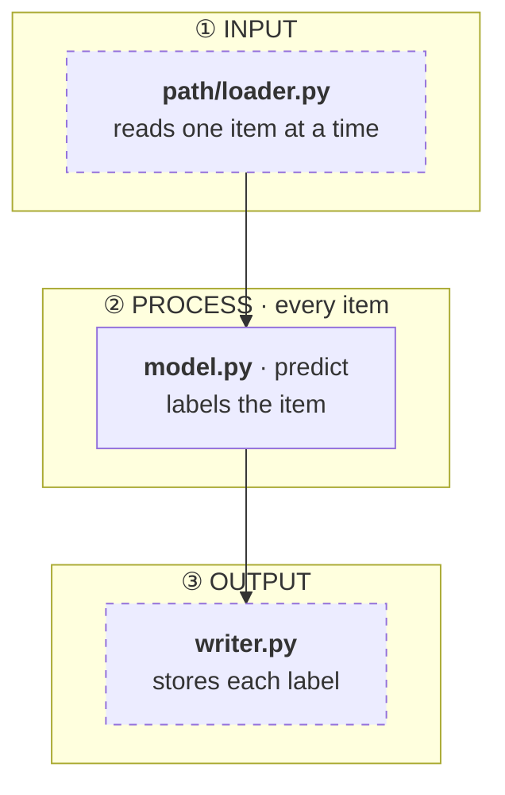

# Structure

The output is one file, `<folder>/STRUCTURE.md`, whose centrepiece is a Mermaid figure that
reads top to bottom: **Input → Process → Output**. A reader should grasp the framework in under
a minute, then use the boxes to find the files. Only the given folder is drawn; files outside
it appear only where they feed it or receive from it.

```bash
S=~/.claude/skills/structure/structure.py
python3 $S scan  <folder>                 # inventory: files, aims, definitions, imports, path loads
python3 $S check <folder>/STRUCTURE.md    # every file / function named in the figure exists
```

## Steps

1. **Inventory.** Run `scan`. Note the entry points (`ENTRY`, `build`, `main`), and *loads by path*:
   code wired through `importlib` or string paths never shows as an import.
2. **Trace the live path.** Start from the entry the project actually uses and follow the calls in
   the code, not the file names. Separate what runs from what is shipped but unused.
3. **Find the blocks.** Decide them from the control flow; there is no fixed template.
   - **Input:** what enters the folder from outside: data, checkpoints, config, the caller.
   - **Output:** what leaves it: predictions, saved state, files, return values.
   - **Process:** split into one block per **trigger**, meaning when the code runs: once at setup,
     per item, every N items, on a condition, at the end. Start a new block wherever the trigger or
     the data handed on changes. A simple scope may have one process block; do not invent blocks.
4. **Draw.** One box per file, or per file · function when one file plays two roles. Each box has
   the **bold path** and a short aim (≤ 10 words, plain language). Arrows carry what flows; label
   them when it isn't obvious. Draw feedback (state used later) as a dashed arrow. Files outside the
   folder use the `ext` class (dashed border).
5. **Write the rest of the page,** short:
   - a three-line "How to read it" under the figure;
   - a table mapping the parts onto the project's own vocabulary, if the project has one;
   - key settings;
   - one line listing what is present but not on the live path.
6. **Check.** Run `check`; fix every FAIL.

**Done when** `check` passes, every file on the live path appears in exactly one box, and every
box was read in the code, not inferred from its name.

## Figure conventions

- Paths are relative to the folder. Files outside it are written relative to the project root
  (e.g. `tools/run.py`), and `check` finds them through the enclosing folders.
- Citation format, which `check` parses: `<b>path/file.py</b>` optionally followed by ` · symbol`
  (a function, a class, or `Class.method`).



## Updating

When code in a folder with a `STRUCTURE.md` changes, re-trace only the affected blocks, update
their boxes, and rerun `check`.

## Viewing

The figure is Mermaid. It renders in VS Code with the "Markdown Preview Mermaid Support"
extension, and natively on GitHub and in Notion code blocks set to Mermaid.
